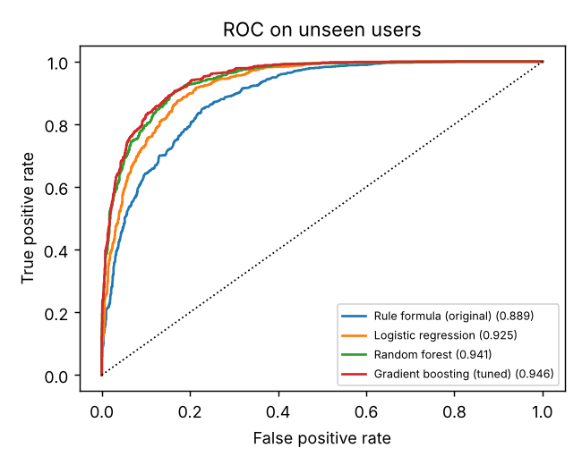
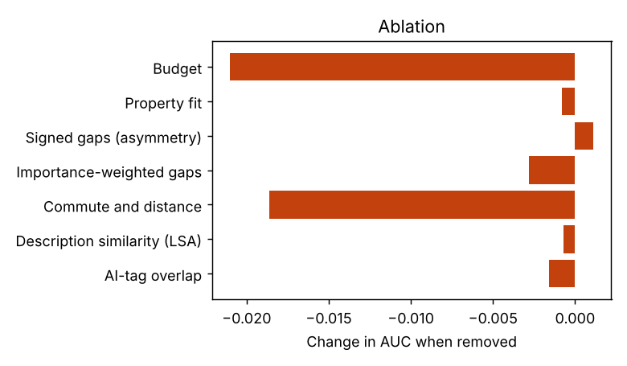
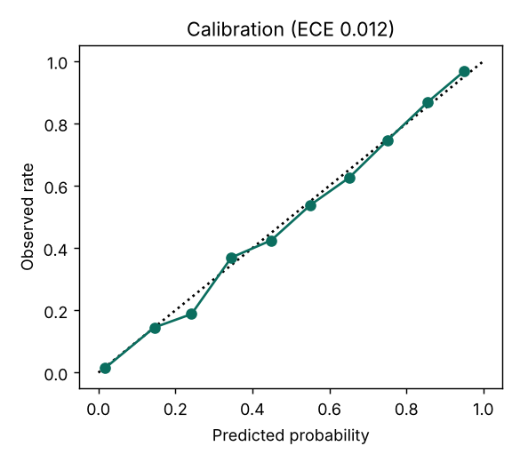
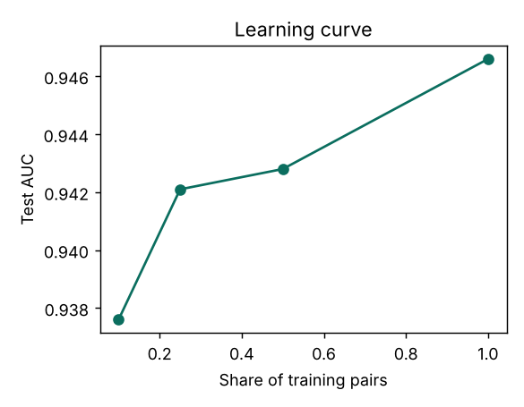
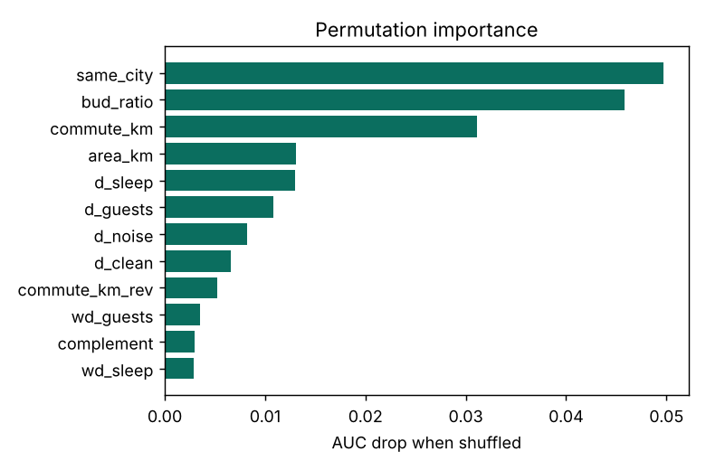
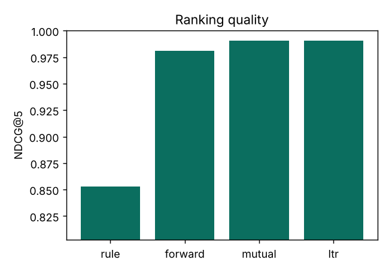

# RoomieMatch machine learning report

Generated by `python -m pipeline.evaluate` in under a few minutes. All numbers are measured on **test users who appear in no training pair**.

## 1. Problem and data
RoomieMatch ranks potential roommates and explains why. Real interaction data does not exist yet, so the models bootstrap from a **synthetic world**: 1500 users drawn from lifestyle archetypes with templated descriptions, and 60000 labelled pairs whose outcome comes from a hidden, non-linear preference function plus noise (40% positive). The hidden function was written by the project author, so these results show that the pipeline recovers structure that exists in the data. They do **not** show accuracy on real people. The retraining loop (`npm run ai:retrain`) and the validation plan in section 9 address this.

## 2. Evaluation protocol (leakage control)
Users are split 70% / 10% / 20%. The compatibility model trains only on pairs where both users are in the 70% part (29469 pairs); 590 pairs from the 10% part tune hyperparameters; the final 2443 test pairs involve only the 20% of users who were never seen. The tag and description-embedding models used for the evaluation features are fitted on the 80% only. A random pair split (the original protocol, where the same users sit on both sides) is reported by `train.py` as `auc_leaky_split` for comparison; in this synthetic world it barely inflates the score, but on real data, where users repeat and behave consistently, it would.

## 3. Compatibility: models compared
| Model | AUC (unseen users) |
|---|---|
| Rule formula (original) | 0.889 |
| Logistic regression | 0.9246 |
| Random forest | 0.941 |
| Gradient boosting (tuned) | 0.9461 |

Best: **Gradient boosting (tuned)**. Improvement over the original hand-written formula: bootstrap 95% interval for the AUC difference is 0.0485 to 0.066. Five repeated user-disjoint splits give AUC 0.9448 ± 0.0049. Tuned parameters: `{'max_depth': 4, 'learning_rate': 0.1, 'max_iter': 200}`.

## 4. Ablation: what each feature group contributes
| Removed group | AUC | Change |
|---|---|---|
| AI-tag overlap | 0.9445 | -0.0016 |
| Description similarity (LSA) | 0.9454 | -0.0007 |
| Commute and distance | 0.9275 | -0.0186 |
| Importance-weighted gaps | 0.9433 | -0.0028 |
| Signed gaps (asymmetry) | 0.9472 | 0.0011 |
| Property fit | 0.9453 | -0.0008 |
| Budget | 0.9251 | -0.021 |

Groups whose removal changes AUC by less than 0.002, or improves it, are not earning their place here: AI-tag overlap, Description similarity (LSA), Signed gaps (asymmetry), Property fit. That is a finding, not a bug: either the hidden preference function does not use them much, or other features already carry the same information.

## 5. Calibration and data efficiency
Expected calibration error: **0.0121**. The product shows a softened score (probability passed through a temperature), so users see 0 to 100 values without extreme 0 and 99. The learning curve shows how much data the model needs:

| Share of training pairs | AUC |
|---|---|
| 0.1 | 0.9376 |
| 0.25 | 0.9421 |
| 0.5 | 0.9428 |
| 1.0 | 0.9466 |

 

## 6. What the model relies on (permutation importance)
| Feature | AUC drop when shuffled |
|---|---|
| same_city | 0.0497 |
| bud_ratio | 0.0458 |
| commute_km | 0.0311 |
| area_km | 0.0131 |
| d_sleep | 0.013 |
| d_guests | 0.0108 |
| d_noise | 0.0082 |
| d_clean | 0.0066 |
| commute_km_rev | 0.0052 |
| wd_guests | 0.0035 |
| complement | 0.003 |
| wd_sleep | 0.0029 |

## 7. Fairness slices
Slices by the city and the role of the person being served (groups with at least 80 test pairs). Large AUC or calibration gaps would signal that the model serves some groups worse.

| Slice | Pairs | AUC | Mean predicted minus observed |
|---|---|---|---|
| city=faisalabad | 734 | 0.943 | -0.002 |
| city=islamabad | 513 | 0.933 | 0.001 |
| city=lahore | 598 | 0.941 | 0.018 |
| city=london | 313 | 0.948 | -0.011 |
| city=toronto | 285 | 0.974 | -0.008 |
| role=host | 1193 | 0.944 | -0.002 |
| role=seeker | 1250 | 0.948 | 0.005 |

## 8. Ranking, tags and text models
**Ranking.** The product orders people, so the main metric is NDCG@5 over candidate lists (300 test users, 30 candidates each, relevance = the true probability that both people would say yes). Rule formula 0.8527; one-way model 0.9811; two-way (mutual) score 0.9904; learning-to-rank re-ranker 0.9906. In this run the re-ranker would be **not chosen**; the product makes the same decision at training time and records it in `models/meta.json`. One-way scores ignore the other person's view, so they lose to the two-way scores when a match needs both sides to agree.

**Tags (1 to 2 per profile).** Candidates are ranked by probability times informativeness. Precision is measured against the synthetic ground truth, so it is optimistic. With a description: precision 1.0, 1.96 tags shown on average, coverage 0.997. Without a description only a structured-answers model may add one confident tag: precision 1.0, coverage 0.97 (the rest are left untagged on purpose).

**Description reader on unseen wording.** The reader trains on templated sentences, so its near-perfect template score is optimistic. As an honest check, 30 freely written descriptions (`tests/wild_descriptions.json`, not used for training) give:

| System | Accuracy | Labels checked |
|---|---|---|
| ML + rules (product) | 0.887 | 53 |
| ML only | 0.509 | 53 |
| Rules only | 0.774 | 53 |

## 9. Limitations and next steps
- **Synthetic labels.** Replace them with real outcomes: the in-app accept/decline loop, a short survey where classmates rate hypothetical roommate pairs, and a public pairing dataset such as the Speed Dating Experiment (8,378 dates with mutual decisions) to validate the two-way modelling idea, remembering that it is romantic rather than roommate matching.
- **Templated text.** Section 8 shows the gap on freely written descriptions; collect real descriptions and label a few hundred.
- **Commute coordinates** in `shared/places.json` are approximate demo values.
- The hidden preference function favours the features it was built from, so ablations on real data may look different.
